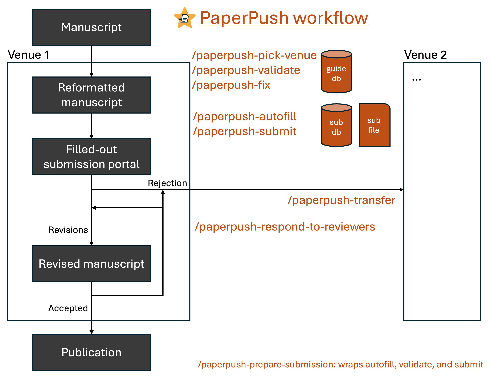
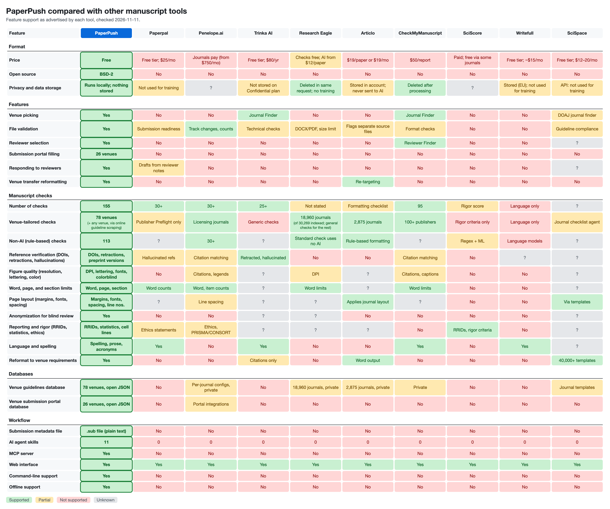

<p align="center">
  
</p>

<h1 align="center">PaperPush</h1>

<p align="center">
  <strong>A toolkit and AI companion for scientific publishing</strong><br>
  Prepare manuscripts for submission to preprint servers, journals, and conferences with just a few commands.
</p>

<p align="center">
  <a href="https://paperpush.onrender.com"></a>
  <a href="https://paperpush.readthedocs.io/en/latest/?badge=latest"></a>
  <a href="https://pypistats.org/packages/paperpush"></a>
  <a href="https://pypi.org/project/paperpush/"></a>
  <a href="https://github.com/pachterlab/paperpush/actions/workflows/ci.yml"></a>
  <a href="https://github.com/pachterlab/paperpush/blob/main/LICENSE"></a>
</p>

PaperPush provides the following services:
- A standardized system to share all metadata submitted to a venue (the .sub file - [see an example here](https://paperpush.readthedocs.io/en/latest/sub-file.html#sub-file-example))
<!-- BEGIN VALIDATION CHECK COUNT -->
- Extensive venue-specific manuscript guideline checking including section lengths, reference hallucination, figure resolution, link validation, anonymization, and much, much more — 155 distinct validation check types in total. [See the full list](https://paperpush.readthedocs.io/en/latest/validation-checks.html)
<!-- END VALIDATION CHECK COUNT -->
- A central database of journal/conference [manuscript requirements](https://paperpush.readthedocs.io/en/latest/schemas/manuscript_requirements.html) ([`paperpush/manuscript_requirements.json`](https://github.com/pachterlab/paperpush/blob/main/paperpush/manuscript_requirements.json)) and [submission data](https://paperpush.readthedocs.io/en/latest/schemas/submission_forms.html) ([`paperpush/submission_forms.json`](https://github.com/pachterlab/paperpush/blob/main/paperpush/submission_forms.json))
- Automated and fast submission portal filling with deterministic scripts - [see an example here](https://paperpush.readthedocs.io/en/latest/submission-portal.html)
- [AI skills](https://paperpush.readthedocs.io/en/latest/quickstart/ai.html#what-to-ask) with an MCP server, a [website](https://paperpush.onrender.com), and a [command line interface](https://paperpush.readthedocs.io/en/latest/commands/index.html)
- Free, open-source, actively-maintained, and never stores your data

## Install

For AI agent skills and CLI usage:

```bash
pip install paperpush["all"]  # Recommended — for AI API usage, MCP server, local web deployment, and additional manuscript validation checks
pip install paperpush  # basic CLI usage
```

(Required for `submit`): To install the playwright dependency and the required chromium browser, run:

```bash
playwright install chromium
```

## Quickstart

Choose your favorite mode: AI agent skills, website, or command line. All modes support venue-specific metadata collection, venue-tailored checking, and submission portal filling for supported venues. AI agents support additional tasks.

### AI agent skills

#### Install in Claude Code (other AI agents listed below)
- `/plugin marketplace add pachterlab/paperpush`
- (In a new session): `/plugin install paperpush@paperpush`

#### Venue-specific metadata collection, venue-tailored checking, and submission portal filling for a supported venue
- `/paperpush-prepare-submission Prepare my manuscript in /PATH/TO/MANUSCRIPT/DIRECTORY for submission to VENUE with PaperPush.`

#### Venue-specific metadata collection and venue-tailored checking for an unsupported venue
- `/paperpush-prepare-submission Prepare my manuscript in /PATH/TO/MANUSCRIPT/DIRECTORY for submission to VENUE_NAME with PaperPush.`

#### Choosing a venue
- `/paperpush-pick-venue Suggest venues for my manuscript in /PATH/TO/MANUSCRIPT/DIRECTORY with PaperPush.`

#### General manuscript checking
- `/paperpush-validate Validate my manuscript in /PATH/TO/MANUSCRIPT/DIRECTORY with PaperPush.`

#### Manuscript venue transfer reformatting
- `/paperpush-transfer Transfer my manuscript in /PATH/TO/MANUSCRIPT/DIRECTORY to VENUE_2 with PaperPush.`

#### Respond to reviewers
- `/paperpush-respond-to-reviewers Prepare my response to reviewers in /PATH/TO/MANUSCRIPT/DIRECTORY with PaperPush.`

### Website

[paperpush.onrender.com](https://paperpush.onrender.com)

No installation required.

#### Venue-specific metadata collection, venue-tailored checking, and submission portal filling for a supported venue
- Visit [paperpush.onrender.com](https://paperpush.onrender.com)
- Select the VENUE (or upload a .sub file)
  - For general manuscript checks, select "General"
- Upload manuscript files and fill out the metadata fields
- Click the blue "Validate" button to validate the files and metadata against author guidelines
- Click the blue "Share" button to share the editable form with co-authors (or download and share the .sub file)
- (If available) Click the "Fill out submission portal automatically" button and follow the instructions

### Command line interface

#### Venue-specific metadata collection, venue-tailored checking, and submission portal filling for a supported venue
- `paperpush subfile VENUE`  # create a .sub file (`paperpush subfile general` if you have not chosen a venue yet)
- Fill out VENUE.sub.txt  # or agent skill /paperpush-autofill
- `paperpush validate VENUE.sub.txt`  # validate the files and data in VENUE.sub.txt  # or agent skill /paperpush-validate
  - For general manuscript checks, run: `paperpush validate --manuscript MANUSCRIPT ...`
- Share VENUE.sub.txt with co-authors (it can be viewed in a text editor, with `paperpush web VENUE.sub.txt`, or via upload onto [paperpush.onrender.com](https://paperpush.onrender.com))
- (If available) `paperpush login VENUE`  # log in to the VENUE submission portal
- (If available) `paperpush submit VENUE.sub.txt`  # fill out the VENUE submission portal with information in VENUE.sub.txt  # or agent skill /paperpush-submit
  - Or run every step above in one command: `paperpush prepare-submission VENUE -p MANUSCRIPT_DIR` (autofills through an LLM API key)
  - `submit` is for **initial submissions only**. Upload a revision through the venue's own "submit revision" link for the existing manuscript (prepare it with `/paperpush-respond-to-reviewers`)

## Use with AI

Install the paperpush skills for your agent, so it knows how to autofill, validate, and submit:

**Claude Code** (two separate prompts):

```
/plugin marketplace add pachterlab/paperpush
```
```
/plugin install paperpush@paperpush
```

**Codex:**

```bash
codex plugin marketplace add pachterlab/paperpush
codex plugin add paperpush@paperpush
```

**From a pip install** (any agent):

```bash
paperpush install-skills                 # Claude Code, every project (~/.claude/skills)
paperpush install-skills --agent codex   # Codex (~/.codex/skills)
paperpush install-skills --dest DIR      # any other agent's skills directory
```

Then ask:

```LLM
/paperpush-prepare-submission Prepare my manuscript in /PATH/TO/MANUSCRIPT/DIRECTORY for submission to VENUE with PaperPush.
```

See [`docs/example-session.md`](docs/example-session.md) for a full worked example of this flow.

## CLI usage

Use the agent skill `/paperpush-prepare-submission` to run this entire pipeline.

1. `paperpush subfile VENUE`: creates a file VENUE.sub.txt that is a template for the VENUE submission. Fields are grouped into the same sections for every venue (manuscript type, files, details, authors, reviewers, declarations, additional); add `--venue-order` to list them in the order the venue's portal asks for them instead.
2. **fill out VENUE.sub.txt:** Open VENUE.sub.txt in a text editor to edit manually, or run `paperpush web VENUE.sub.txt` to edit in a web browser. Use the agent skill `/paperpush-autofill My manuscript files are in /PATH/TO/MANUSCRIPT/DIRECTORY. Fill out VENUE.sub.txt` or the command `paperpush autofill --engine api -p /PATH/TO/MANUSCRIPT/DIRECTORY ... VENUE.sub.txt` (API) to automatically fill from the manuscript directory with AI. `paperpush autofill` requires the provider's API key. The AI agent may not be able to fill out all fields if some information is not in the manuscript directory.
3. `paperpush validate VENUE.sub.txt`: run the pre-submission checks on the filled `VENUE.sub.txt`. Use the agent skill `/paperpush-validate` or the CLI flag `--ai` (API) to run checks with AI. The AI checks require the provider's API key. To check files without a `.sub`, name them instead: `paperpush validate --manuscript main.tex --title-page title.tex --figures fig1.png fig2.png ...` runs the checks that apply to any manuscript (links, references, hidden text, citation order, prose, etc.), and adding `--venue VENUE` checks them against that venue's author guidelines too. Use the agent skill `/paperpush-fix` to fix the issues validate finds: it edits the manuscript sources and the `.sub`, validates again until nothing fixable is left, and reports what needs your decision.
4. `paperpush login VENUE`: log in to the VENUE submission portal.
5. `paperpush submit VENUE.sub.txt`: Fill out the VENUE submission portal. Will not actually submit the manuscript. We highly recommend reviewing the submission form in the venue portal before clicking submit. Use the agent skill `/paperpush-submit` to run login and submit on a .sub file. Use the agent skill `/paperpush-portal-debug` or the CLI flag `--ai` (API) to have AI fix any issues that may arise. Ignore validation checks with the `--skip-validate` flag. **Use `submit` only for initial submissions**: it opens a new submission, so a revision sent this way becomes a duplicate. Upload revisions through the venue's own "submit revision" link instead (`/paperpush-respond-to-reviewers` prepares the revised manuscript, marked manuscript, and response to reviewers). `submit` warns and asks before continuing when the `.sub` is in a `revisionN/` directory or sits beside a response-to-reviewers document (`--yes` skips the question).

Helper commands:
- `paperpush venues`: List supported venues.
- `paperpush publishers`: List the publishers whose house rules back their venues' own guidelines. Where a venue's guidelines are silent, its publisher's house rules apply, reported as warnings.
- `paperpush update-venues`: Update the venue data (venues.json, submission_forms.json, manuscript_requirements.json) from the remote venue-data branch.
- `paperpush requirements VENUE`: print VENUE's author guidelines, if available. Rules marked `*` come from its publisher's house rules.
- `paperpush pick-venue`: List journals that are a good thematic fit for your manuscript. Give keywords, the manuscript, or its `--title` and `--abstract`. By default it searches any journal, through the works most similar to yours in [OpenAlex](https://openalex.org), and marks the ones PaperPush supports; `--paperpush-supported-only` ranks only the venues supported in PaperPush (offline). It only checks for thematic fit, not impact or likelihood of acceptance.
- `paperpush format VENUE.sub.txt`: reformat the manuscript (.docx or LaTeX) for VENUE. It first looks for the venue's own Word or LaTeX template (the recorded template link, then the venue's author-guideline pages) and applies it; without one it applies the venue's layout rules (page size, margins, font, spacing, line and page numbers). The original is never changed; the result and a CHANGES.md go to a new directory. `--list-templates` only shows the templates found.
- `paperpush convert --manuscript FILE --to docx|tex`: convert a manuscript from Markdown to Word or LaTeX, or between Word and LaTeX. Equations become editable Word equations, citations and cross-references stay live, and a .docx made from LaTeX converts back with every unedited block restored exactly. `--no-source` leaves the LaTeX out of a .docx bound for a journal. The result and a CONVERSION.md, which compares source and output, go to a new directory.
- `paperpush find-reviewers VENUE.sub.txt`: Suggest peer reviewers who recently published similar work (from OpenAlex), leaving out the manuscript's authors, their recent co-authors, colleagues at their institutions, and anyone you `--exclude`. `--write` adds the suggestions to the .sub's reviewer field; fill in their e-mail addresses, which OpenAlex does not have.
- `paperpush options VENUE.FIELD`: print the allowed values for FIELD in VENUE's submission form.
- `paperpush web VENUE.sub.txt`: open a sub file in a local deployment of the web application

See the YouTube tutorial [PaperPush Tutorial](https://youtu.be/ChCYoud0uBk)

## Documentation

[paperpush.readthedocs.io](https://paperpush.readthedocs.io)

## Supported venues

`paperpush validate --manuscript main.tex` runs general-purpose checks (links, references, hidden text, citation order, prose, ...) on any manuscript, whether or not its venue is listed below.

<!-- BEGIN SUPPORTED VENUES -->
**Preprint servers**

| Venue | Slug | Validate + basic .sub | Submit + full .sub |
| --- | --- | :---: | :---: |
| [alphaXiv](https://www.alphaxiv.org) | `alphaxiv` | ✅ | ✅ |
| [arXiv](https://arxiv.org) | `arxiv` | ✅ | ✅ |
| [bioRxiv](https://www.biorxiv.org) | `biorxiv` | ✅ | ✅ |
| [medRxiv](https://www.medrxiv.org) | `medrxiv` | ✅ | ✅ |

**Journals**

| Venue | Slug | Validate + basic .sub | Submit + full .sub |
| --- | --- | :---: | :---: |
| [AJHG](https://www.cell.com/ajhg) | `ajhg` | ✅ |  |
| [Bioinformatics](https://academic.oup.com/bioinformatics) | `bioinformatics` | ✅ | ✅ |
| [BMC Bioinformatics](https://link.springer.com/journal/12859) | `bmc_bioinformatics` | ✅ | ✅ |
| [BMC Biology](https://bmcbiol.biomedcentral.com) | `bmc_biology` | ✅ |  |
| [BMC Genomics](https://bmcgenomics.biomedcentral.com) | `bmc_genomics` | ✅ |  |
| [BMC Medicine](https://bmcmedicine.biomedcentral.com) | `bmc_medicine` | ✅ |  |
| [The BMJ](https://www.bmj.com) | `bmj` | ✅ |  |
| [Cell](https://www.cell.com/cell/home) | `cell` | ✅ | ✅ |
| [Cell Genomics](https://www.cell.com/cell-genomics/home) | `cell_genomics` | ✅ | ✅ |
| [Cell Reports](https://www.cell.com/cell-reports) | `cell_reports` | ✅ |  |
| [Cell Reports Methods](https://www.cell.com/cell-reports-methods) | `cell_reports_methods` | ✅ |  |
| [Cell Stem Cell](https://www.cell.com/cell-stem-cell) | `cell_stem_cell` | ✅ |  |
| [Cell Systems](https://www.cell.com/cell-systems/home) | `cell_systems` | ✅ | ✅ |
| [Combinatorica](https://link.springer.com/journal/493) | `combinatorica` | ✅ | ✅ |
| [Communications Biology](https://www.nature.com/commsbio) | `communications_biology` | ✅ |  |
| [Discrete Mathematics](https://www.sciencedirect.com/journal/discrete-mathematics) | `discrete_mathematics` | ✅ | ✅ |
| [eLife](https://elifesciences.org) | `elife` | ✅ |  |
| [European Radiology](https://link.springer.com/journal/330) | `european_radiology` | ✅ |  |
| [Frontiers in Bioinformatics](https://www.frontiersin.org/journals/bioinformatics) | `frontiers_bioinformatics` | ✅ |  |
| [Frontiers in Genetics](https://www.frontiersin.org/journals/genetics) | `frontiers_genetics` | ✅ |  |
| [Frontiers in Immunology](https://www.frontiersin.org/journals/immunology) | `frontiers_immunology` | ✅ |  |
| [Genome Biology](https://genomebiology.biomedcentral.com) | `genome_biology` | ✅ | ✅ |
| [Genome Medicine](https://genomemedicine.biomedcentral.com) | `genome_medicine` | ✅ |  |
| [Genome Research](https://genome.cshlp.org) | `genome_research` | ✅ |  |
| [IEEE TMI](https://ieeetmi.org/) | `ieee_tmi` | ✅ |  |
| [IEEE TNNLS](https://cis.ieee.org/publications/t-neural-networks-and-learning-systems) | `ieee_tnnls` | ✅ |  |
| [IEEE TPAMI](https://www.computer.org/csdl/journal/tp) | `ieee_tpami` | ✅ |  |
| [iScience](https://www.cell.com/iscience) | `iscience` | ✅ |  |
| [JAMA](https://jamanetwork.com/journals/jama) | `jama` | ✅ |  |
| [JIIM](https://link.springer.com/journal/10278) | `jiim` | ✅ |  |
| [JMLR](https://www.jmlr.org) | `jmlr` | ✅ |  |
| [JNM](https://jnm.snmjournals.org) | `jnm` | ✅ |  |
| [The Lancet](https://www.thelancet.com/journals/lancet/home) | `lancet` | ✅ |  |
| [Lancet Digital Health](https://www.thelancet.com/journals/landig/home) | `lancet_digital_health` | ✅ |  |
| [Medical Image Analysis](https://www.sciencedirect.com/journal/medical-image-analysis) | `medical_image_analysis` | ✅ |  |
| [Molecular Cell](https://www.cell.com/molecular-cell) | `molecular_cell` | ✅ |  |
| [NAR Cancer](https://academic.oup.com/narcancer) | `nar_cancer` | ✅ |  |
| [NAR Genomics and Bioinformatics](https://academic.oup.com/nargab) | `nar_genomics_bioinformatics` | ✅ |  |
| [Nature](https://www.nature.com) | `nature` | ✅ | ✅ |
| [Nature Biomedical Engineering](https://www.nature.com/natbiomedeng) | `nature_biomedical_engineering` | ✅ | ✅ |
| [Nature Biotechnology](https://www.nature.com/nbt) | `nature_biotech` | ✅ | ✅ |
| [Nature Cell Biology](https://www.nature.com/ncb) | `nature_cell_biology` | ✅ |  |
| [Nature Communications](https://www.nature.com/ncomms) | `nature_communications` | ✅ |  |
| [Nature Computational Science](https://www.nature.com/natcomputsci) | `nature_computational_science` | ✅ |  |
| [Nature Genetics](https://www.nature.com/ng) | `nature_genetics` | ✅ |  |
| [Nature Machine Intelligence](https://www.nature.com/natmachintell) | `nature_machine_intelligence` | ✅ | ✅ |
| [Nature Medicine](https://www.nature.com/nm) | `nature_medicine` | ✅ |  |
| [Nature Methods](https://www.nature.com/nmeth) | `nature_methods` | ✅ | ✅ |
| [Nature Neuroscience](https://www.nature.com/neuro) | `nature_neuroscience` | ✅ |  |
| [Nature Structural & Molecular Biology](https://www.nature.com/nsmb) | `nature_structural_molecular_biology` | ✅ |  |
| [NEJM](https://www.nejm.org) | `nejm` | ✅ |  |
| [Neuron](https://www.cell.com/neuron) | `neuron` | ✅ |  |
| [npj Digital Medicine](https://www.nature.com/npjdigitalmed) | `npj_digital_medicine` | ✅ |  |
| [Nucleic Acids Research](https://academic.oup.com/nar) | `nucleic_acids_research` | ✅ | ✅ |
| [Patterns](https://www.cell.com/patterns) | `patterns` | ✅ |  |
| [PLOS Biology](https://journals.plos.org/plosbiology/) | `plos_biology` | ✅ |  |
| [PLOS Computational Biology](https://journal.plos.org/ploscompbiol/) | `plos_compbio` | ✅ | ✅ |
| [PLOS Genetics](https://journals.plos.org/plosgenetics/) | `plos_genetics` | ✅ |  |
| [PLOS Medicine](https://journals.plos.org/plosmedicine/) | `plos_medicine` | ✅ |  |
| [PLOS ONE](https://journals.plos.org/plosone/) | `plos_one` | ✅ |  |
| [PNAS](https://www.pnas.org) | `pnas` | ✅ |  |
| [Radiology](https://pubs.rsna.org/journal/radiology) | `radiology` | ✅ |  |
| [Radiology: Artificial Intelligence](https://pubs.rsna.org/journal/ai) | `radiology_ai` | ✅ |  |
| [Science](https://www.science.org/journal/science) | `science` | ✅ | ✅ |
| [Science Advances](https://www.science.org/journal/sciadv) | `science_advances` | ✅ | ✅ |
| [Science Immunology](https://www.science.org/journal/sciimmunol) | `science_immunology` | ✅ | ✅ |
| [Science Robotics](https://www.science.org/journal/scirobotics) | `science_robotics` | ✅ | ✅ |
| [Science Signaling](https://www.science.org/journal/signaling) | `science_signaling` | ✅ | ✅ |
| [Science Translational Medicine](https://www.science.org/journal/stm) | `science_translational_medicine` | ✅ | ✅ |
| [Scientific Reports](https://www.nature.com/srep) | `scientific_reports` | ✅ |  |
| [TMLR](https://jmlr.org/tmlr/) | `tmlr` | ✅ |  |

**Conferences**

| Venue | Slug | Validate + basic .sub | Submit + full .sub |
| --- | --- | :---: | :---: |
| [ACL Rolling Review](https://aclrollingreview.org) | `acl_arr` | ✅ |  |
| [CVPR 2027](https://cvpr.thecvf.com/Conferences/2027) | `cvpr_2027` | ✅ |  |
| [NAACL 2027 Demo Track](https://2027.naacl.org) | `naacl_2027_demo` | ✅ | ✅ |
<!-- END SUPPORTED VENUES -->

View the list on the command line with `paperpush venues`.

Venues are added (for validate) and updated (for validate and submit) daily. `paperpush update-venues` updates immediately.

New venues are added for submit with paperpush releases - `pip install -U paperpush`.

## Adding new venues

Each venue is listed in `paperpush/venues.json` (the master list of venues and their general metadata), `paperpush/manuscript_requirements.json` (the manuscript guidelines), and `paperpush/submission_forms.json` (the fields the portal asks for). The script for automatic venue login and submission lives in `/paperpush/venues/PLATFORM/VENUE.py` in a VENUE class with methods `login` and `submit`. See [`CONTRIBUTING.md`](CONTRIBUTING.md) and [`DEVELOPMENT.md`](DEVELOPMENT.md) for more details.

## AI Skills

| Skill | Use it to | Example prompt |
| --- | --- | --- |
| `/paperpush-pick-venue` | suggest venues for a manuscript: journals that publish similar work, checked against your constraints (open access, APC budget) and each supported venue's limits, then hand the chosen one to `/paperpush-prepare-submission` | `/paperpush-pick-venue Where should I submit my manuscript in MANUSCRIPT_DIRECTORY? It must be open access with an APC under $3000.` |
| `/paperpush-prepare-submission` | go from a manuscript directory to a filled-in portal (autofill, validate, submit if supported) | `/paperpush-prepare-submission Prepare my manuscript in MANUSCRIPT_DIRECTORY for submission to VENUE.` |
| `/paperpush-autofill` | fill a `.sub` from the manuscript files | `/paperpush-autofill My manuscript files are in MANUSCRIPT_DIRECTORY. Fill out VENUE.sub.txt.` |
| `/paperpush-validate` | run every check, including the ones that need a reader | `/paperpush-validate Validate VENUE.sub.txt and save the report as REPORT.pdf.` |
| `/paperpush-fix` | fix what validate flags (in the `.tex`/`.docx` sources and the `.sub`), re-validate until nothing fixable is left, and report what needs the author | `/paperpush-fix Fix the issues validate found in VENUE.sub.txt.` |
| `/paperpush-submit` | log in and fill in the portal from a ready `.sub` (optionally skipping validation) — invokes `/paperpush-portal-debug` if it stalls | `/paperpush-submit Fill out the VENUE submission portal from VENUE.sub.txt.` |
| `/paperpush-portal-debug` | get a stalled `paperpush submit` run unstuck | `/paperpush-portal-debug paperpush submit VENUE.sub.txt is stuck at the STEP step.` |
| `/paperpush-transfer` | reformat a manuscript from one venue to another: copy the files into a new `<venue>/` directory, create and autofill its `.sub` (reusing earlier `.sub` files), validate, and write `transfer.txt` describing the changes | `/paperpush-transfer My manuscript in MANUSCRIPT_DIRECTORY was rejected from OLD_VENUE. Transfer it to NEW_VENUE.` |
| `/paperpush-respond-to-reviewers` | prepare a revision in two phases: (1) copy the manuscript and reviews into a new `revisionN/` directory (e.g., revision1, revision2, etc.) and propose a plan for each comment, then (once you approve) (2) revise the manuscript; write the response to reviewers, the clean revised manuscript, and a marked manuscript; and validate the revised manuscript | `/paperpush-respond-to-reviewers The reviews for my manuscript in MANUSCRIPT_DIRECTORY are in REVIEWS_FILE. Prepare the revision.` |
| `/paperpush-add-venue-validate` | add or refresh a venue's author guidelines (contributors) | `/paperpush-add-venue-validate Add VENUE's author guidelines from GUIDELINES_URL.` |
| `/paperpush-add-venue` | run `/paperpush-add-venue-validate` and add `login` and `submit` support for a venue, with tests (contributors) | `/paperpush-add-venue Add login and submit support for VENUE.` |

[](docs/_static/schematic.pdf)

## What is a .sub file

The .sub file is the yaml-like text file that contains all metadata and file paths required to upload a manuscript onto a venue's submission portal. An example snippet is shown below. In this case, you would provide "/PATH/TO/MANUSCRIPT.pdf", "TITLE", and "HERE IS THE ABSTRACT".

```venue.sub.txt
@venue: venue

# Manuscript file (file, REQUIRED)
#   Path to the submission.
manuscript_file: /PATH/TO/MANUSCRIPT.pdf

# Title (text, REQUIRED)
#   The full title of the article.
title: TITLE

# Abstract (textarea, REQUIRED)
#   Plain-text abstract, at least 20 characters
abstract: |
  HERE IS THE ABSTRACT
```

See a full, filled-in example [here](https://paperpush.readthedocs.io/en/latest/sub-file.html#sub-file-example) (from [tests/sub_files/arxiv/arxiv.sub.txt](tests/sub_files/arxiv/arxiv.sub.txt)).

## MCP server

To drive paperpush from any MCP client — Claude Desktop, an IDE extension — run
it as an MCP server:

```bash
pip install 'paperpush[mcp]'
```

```json
{
  "mcpServers": {
    "paperpush": {
      "command": "paperpush-mcp"
    }
  }
}
```

The server exposes the whole pipeline as tools. See [`AGENTS.md`](AGENTS.md) for
the tool list and the contract agents should follow.

## Comparison with other tools

[](docs/_static/comparison.pdf)

Green means supported, amber means partial, red means not supported, and grey means unknown. The data reflect what each tool advertises (see the sources in the script), so let us know if something has changed. [PDF version](docs/_static/comparison.pdf). Regenerate with `python scripts/gen_comparison_table.py`.

## FAQ

*How does PaperPush work?*

Supported venues are listed in `paperpush/venues.json`, their submission form data are in `paperpush/submission_forms.json`, and their author guidelines are in `paperpush/manuscript_requirements.json`. `paperpush subfile` generates a file from the form for the specified venue. The file can be filled out manually, or with the help of an LLM via `paperpush autofill`. The manuscript documents are validated with `paperpush validate`. The submission portal for a selected venue is filled out with the information from this file with a `paperpush submit`. This runs a Playwright script that is written specifically for each supported venue.


*The repository says that it supports a given venue, but it fails when I try. Why is that?*

Here are a few possibilities, in order of decreasing ease of resolution:
- Sometimes, submission portals can be a bit funny, and the solution can be as simple as retrying the command 1-2 more times.
- The submission portal is having server issues. You can try logging in to the portal manually to see if it is working, as well as on a different browser and at a different time.
- The sub file has an option that we did not anticipate. You can try running the unit test for the venue with `pytest tests/test_submit.py --run-portal -s --venue VENUE`. If this passes, then it indicates an option in the sub file is not being handled correctly. If this fails, then it indicates that the submission portal has changed since the last time the venue was tested. In either case, please open an issue with the error message.
- The submission portal has changed since the last time the venue was tested. You can run the unit test listed above to see if this is the case. If so, please open an issue with the error message.

*Can I still use PaperPush if my venue is not listed?*
Yes! PaperPush can still validate manuscript files with up to 132 general validation checks. You can do this in the following ways:
- AI agent: Run the skill `/paperpush-validate Validate my manuscript in /PATH/TO/MANUSCRIPT/DIRECTORY with PaperPush.` for general checks, or `/paperpush-prepare-submission Prepare my manuscript in /PATH/TO/MANUSCRIPT/DIRECTORY for submission to VENUE_NAME with PaperPush.` for venue-specific checks in which the agent can retrieve guidelines from the venue's website.
- Website: Choose the "General" venue option and upload your manuscript files/directory for general checks.
- CLI: Run `paperpush validate --manuscript MANUSCRIPT --issn ISSN` (or `--publisher NAME`) to check against the journal's publisher's house rules, when paperpush has them (`paperpush publishers`); what they catch is reported as warnings. Run `paperpush validate --manuscript MANUSCRIPT ...` for general checks, or `paperpush subfile general` for a .sub with the files and metadata every venue asks for (title, abstract, keywords, authors, manuscript, figures, supplements, cover letter, ...), then fill it in and `paperpush validate general.sub.txt`.


*I do not see my venue in the supported list. Is it possible to add a venue?*

Yes! See [`CONTRIBUTING.md`](CONTRIBUTING.md) if you would like to add a journal yourself, and feel free to ask any questions in the Discussion forum. 


*Does PaperPush press submit for me?*

No. PaperPush will bring you to one of the final steps on your venue of interest, but it will never actually press submit. I always recommend viewing any compiled PDFs and entered information to ensure accuracy and acknowledgment of guidelines.


*Does every venue have a unique submission portal?*

No — in fact, many share the same type of platform. PaperPush has a unique Playwright script for each supported venue, but many venues share the same submission platform. The big ones are Editorial Manager (including the Cell family and PLOS family), ScholarOne Manuscripts, eJournalPress, Snapp, and OpenReview (for many computer science conferences). The submission script may be highly similar for venues that share the same platform, so check the folders within `paperpush/venues` to see which venues share the same submission platform. See screenshots of each of the major supported venues in [`docs/portal_screenshots`](docs/portal_screenshots) to see what each submission portal looks like.


*How long does it take to add a new journal?*

It depends on the complexity of the submission portal and your comfort with coding, but I would say roughly 1-3 hours manually. AI tools with the paperpush skills can potentially do this in under 20 minutes.


*Can I vibe code a new journal?*

Yes, with `/paperpush-add-venue` to add or update a venue for guideline validation and submission portal filling, or `/paperpush-add-venue-validate` to add or update a venue for guideline validation only (see [`CONTRIBUTING.md`](CONTRIBUTING.md)). AI agents can navigate submission portals and write the Venue class for login and submit, but it can take a lot of tokens and may stall at times, so some human oversight helps. In my experience, LLMs can make the code a bit verbose and abstract away some of the action names, which may be harder to read/maintain in my opinion, but this is just stylistic. My favorite code style is in `arxiv.py`.

## For AI agents

If you are an AI agent asked to submit a manuscript on the user's behalf, read
[`AGENTS.md`](AGENTS.md) — or, if you are working from a `pip install` rather
than a clone of this repo, run `paperpush --agent-guide`, which prints the same
document from the copy that shipped with the installed version. It describes how to run the full pipeline while doing
your **own** field extraction (reading the manuscript and writing a
`values.json` for the default `--engine manual`) rather than relying on the
API-backed engine. It also asks the agent to check `paperpush login --list`
before it starts, and to tell you right away if you still need to run
`paperpush login <venue>` yourself — that sign-in is interactive and belongs in
your terminal. Agents that support skills should install them (see
[Use with AI](#use-with-ai)); `AGENTS.md` lists what each skill does and when
to use it.


## License

This project is licensed under the BSD-2 License - see the [LICENSE](LICENSE) file for details.

Developed by Joe Rich
