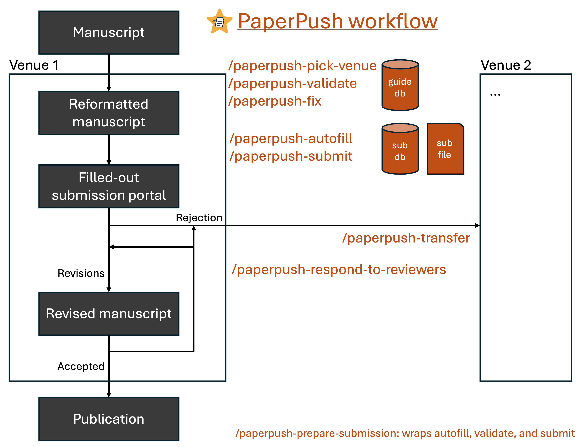

AI agent skills
===============

PaperPush ships its workflows as agent skills. The agent reads your manuscript
and fills in the metadata itself, runs the checks that need a reader's
judgment, and hands the result to PaperPush's deterministic core, which writes,
validates, and fills out the portal.

Install
-------

**Claude Code** (as two separate prompts; the second in a new session):

.. code-block:: text

   /plugin marketplace add pachterlab/paperpush

.. code-block:: text

   /plugin install paperpush@paperpush

For Codex, other agents, and a pip install, see
:ref:`Installation <install-the-ai-agent-skills>`.

What to ask
-----------

Venue-specific metadata collection, venue-tailored checking, and submission portal filling for a supported venue
~~~~~~~~~~~~~~~~~~~~~~~~~~~~~~~~~~~~~~~~~~~~~~~~~~~~~~~~~~~~~~~~~~~~~~~~~~~~~~~~~~~~~~~~~~~~~~~~~~~~~~~~~~~~~~~~~~~

.. code-block:: text

   /paperpush-prepare-submission Prepare my manuscript in /PATH/TO/MANUSCRIPT/DIRECTORY for submission to VENUE with PaperPush.

Venue-specific metadata collection and venue-tailored checking for an unsupported venue
~~~~~~~~~~~~~~~~~~~~~~~~~~~~~~~~~~~~~~~~~~~~~~~~~~~~~~~~~~~~~~~~~~~~~~~~~~~~~~~~~~~~~~~~~~~

.. code-block:: text

   /paperpush-prepare-submission Prepare my manuscript in /PATH/TO/MANUSCRIPT/DIRECTORY for submission to VENUE_NAME with PaperPush.

The agent reads the venue's author guidelines from its website and validates
against them. There is no portal filling for an unsupported venue.

Choosing a venue
~~~~~~~~~~~~~~~~

.. code-block:: text

   /paperpush-pick-venue Suggest venues for my manuscript in /PATH/TO/MANUSCRIPT/DIRECTORY with PaperPush.

General manuscript checking
~~~~~~~~~~~~~~~~~~~~~~~~~~~

.. code-block:: text

   /paperpush-validate Validate my manuscript in /PATH/TO/MANUSCRIPT/DIRECTORY with PaperPush.

Manuscript venue transfer reformatting
~~~~~~~~~~~~~~~~~~~~~~~~~~~~~~~~~~~~~~

.. code-block:: text

   /paperpush-transfer Transfer my manuscript in /PATH/TO/MANUSCRIPT/DIRECTORY to VENUE_2 with PaperPush.

Respond to reviewers
~~~~~~~~~~~~~~~~~~~~

.. code-block:: text

   /paperpush-respond-to-reviewers Prepare my response to reviewers in /PATH/TO/MANUSCRIPT/DIRECTORY with PaperPush.

All skills
----------

.. list-table::
   :header-rows: 1
   :widths: 35 65

   * - Skill
     - Use it to
   * - ``/paperpush-pick-venue``
     - suggest venues for a manuscript: journals that publish similar work,
       checked against your constraints (open access, APC budget) and each
       supported venue's limits, then hand the chosen one to
       ``/paperpush-prepare-submission``
   * - ``/paperpush-prepare-submission``
     - go from a manuscript directory to a filled-in portal (autofill,
       validate, submit if supported)
   * - ``/paperpush-autofill``
     - fill a ``.sub`` from the manuscript files
   * - ``/paperpush-validate``
     - run every check, including the ones that need a reader
   * - ``/paperpush-fix``
     - fix what validate flags (in the ``.tex``/``.docx`` sources and the
       ``.sub``), re-validate until nothing fixable is left, and report what
       needs the author
   * - ``/paperpush-submit``
     - log in and fill in the portal from a ready ``.sub`` (optionally
       skipping validation); invokes ``/paperpush-portal-debug`` if it stalls
   * - ``/paperpush-portal-debug``
     - get a stalled ``paperpush submit`` run unstuck
   * - ``/paperpush-transfer``
     - reformat a manuscript from one venue to another: copy the files into a
       new ``<venue>/`` directory, create and autofill its ``.sub`` (reusing
       earlier ``.sub`` files), validate, and write ``transfer.txt``
       describing the changes
   * - ``/paperpush-respond-to-reviewers``
     - prepare a revision in two phases: (1) copy the manuscript and reviews
       into a new ``revisionN/`` directory (e.g., ``revision1``,
       ``revision2``) and propose a plan for each comment, then (once you
       approve) (2) revise the manuscript; write the response to reviewers,
       the clean revised manuscript, and a marked manuscript; and validate the
       revised manuscript
   * - ``/paperpush-add-venue-validate``
     - add or refresh a venue's author guidelines (contributors)
   * - ``/paperpush-add-venue``
     - run ``/paperpush-add-venue-validate`` and add ``login`` and ``submit``
       support for a venue, with tests (contributors)

Agents without skills, and MCP clients
--------------------------------------

Agents that cannot load skills should read ``AGENTS.md`` (``paperpush
--agent-guide`` from a pip install). It describes how to run the full pipeline
while doing the field extraction themselves, and asks the agent to check
``paperpush login --list`` first and tell you right away if you still need to
run ``paperpush login VENUE``, since that sign-in is interactive and yours to
complete.

To drive PaperPush from any MCP client (Claude Desktop, an IDE extension), run
it as an MCP server; see :ref:`mcp-server`.

For a full worked example of the agent flow, see :doc:`../example-session`.
